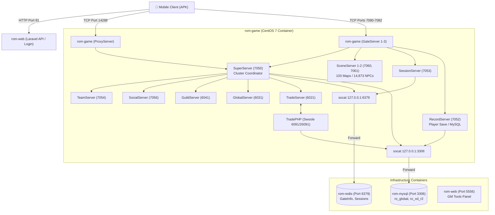

# 🩺 Ragnarok M Server: Architecture & Troubleshooting Guide for AI Agents & Developers

This guide provides an authoritative reference on the Ragnarok M: Eternal Love server architecture, inter-service dependencies, log file paths, state machine lifecycle, and step-by-step diagnostic procedures.

If you are an AI agent or human developer troubleshooting this stack, **read this document first** rather than guessing or restarting random services.

---

## 📑 Table of Contents
1. [Stack Topology & Network Routing](#1-stack-topology--network-routing)
2. [Complete Microservice Inventory (21 Processes)](#2-complete-microservice-inventory-21-processes)
3. [The Startup Sequence & State 3 Golden Rule](#3-the-startup-sequence--state-3-golden-rule)
4. [Exhaustive Log File Map](#4-exhaustive-log-file-map)
5. [Rapid Diagnostic Checklist (Health Verification)](#5-rapid-diagnostic-checklist-health-verification)
6. [Known Issues & Fix Matrix (Symptom -> Cause -> Solution)](#6-known-issues--fix-matrix)
7. [Database & Redis Data Reference](#7-database--redis-data-reference)
8. [Client APK Modding & Gateway Pointers](#8-client-apk-modding--gateway-pointers)

---

## 1. Stack Topology & Network Routing

The stack consists of 4 Docker containers running in an isolated bridge network with port forwarding to the host:



### ⚠️ Critical Architectural Detail: The `socat` Bridge
The legacy C++ game binaries have `127.0.0.1:3306` (MySQL) and `127.0.0.1:6379` (Redis) **hardcoded** in their compiled config loaders.
- To enable clean Docker container separation, `rom-game/entrypoint.sh` runs `socat` daemons in the background:
  - `socat TCP-LISTEN:3306,fork,reuseaddr,bind=127.0.0.1 TCP:db:3306 &`
  - `socat TCP-LISTEN:6379,fork,reuseaddr,bind=127.0.0.1 TCP:redis:6379 &`
- **If any C++ server reports "connect mysql failed" or "connect redis failed":** Check if `socat` is running inside `rom-game` using `docker exec rom-game ps aux | grep socat`.

---

## 2. Complete Microservice Inventory (21 Processes)

All game server binaries reside inside the container at `/RoServercode/bin/Release` (host path: `server/bin/Release/`).

| Service Name | Default Port | Region / Zone | Role Description |
| :--- | :--- | :--- | :--- |
| **`SuperServer`** | `7050` | `xd/r2_s1` | **Cluster Master Orchestrator**. Manages cluster state, synchronizes services, and registers gate endpoints into Redis. |
| **`ProxyServer`** | `14288` | `proxy/1` | **Client Public Front-Gateway**. First TCP connection point for the client to select servers. Requires `libmysqlclient.so.18`! |
| **`GProxyServer`** | `12053` | Global | Global proxy forwarding coordinator. |
| **`GateServer1`** | `7080` | `xd/r2_s1` | Primary player world traffic gateway. Handles client game packets and decrypts session tokens. |
| **`GateServer2`** | `7081` | `xd/r2_s1` | Secondary player traffic gateway. |
| **`GateServer3`** | `7082` | `xd/r2_s1` | Tertiary player traffic gateway. |
| **`SceneServer1`** | `7060` | `xd/r2_s1` | **Main World Engine**. Runs Lua scripts, monster AI, 103 maps, 14,873 NPCs, and physics. Consumes ~14 GB RAM. |
| **`SceneServer2`** | `7061` | `xd/r2_s1` | Secondary world engine (instances, dungeons, guild halls). |
| **`RecordServer`** | `7052` | `xd/r2_s1` | Loads and saves player blobs (`ro_xd_r2.blob_data`, `base_data`) to/from MySQL. |
| **`SessionServer`** | `7053` | `xd/r2_s1` | Authenticates player session tokens against Redis; tracks active logins. |
| **`TeamServer`** | `7054` | `xd/r2_s1` | Party and team mechanics, invites, loot distribution. |
| **`SocialServer`** | `7056` | `xd/r2_s1` | Chat channels, friend lists, blacklists, social messages. |
| **`DataServer`** | `7057` | `xd/r2_s1` | Global static data caching across servers. |
| **`StatServer`** | `6011` | `xd/r2` | Server metrics, telemetry, and statistical logging. |
| **`TradeServer`** | `6021` | `xd/r2` | C++ exchange engine coordinating with PHP daemon. |
| **`GlobalServer`** | `6031` | `xd/r2` | Cross-server logic and global events. |
| **`GuildServer`** | `6041` | `xd/r2` | Guild structures, territories, GvG (War of Emperium). |
| **`GZoneServer`** | `6051` | `xd/r2` | Global cross-zone routing. |
| **`AuctionServer`** | `6061` | `xd/r2` | Auction house transactions and item bidding. |
| **`MatchServer`** | `6071` | `xd/r2` | Arena and PvP matchmaking queues. |
| **`WeddingServer`** | `6081` | `xd/r2` | Marriage and wedding ceremony mechanics. |
| **`TradePHP`** | `6091`, `26091` | PHP Swoole | PHP 7.0 Trade daemon managing exchange orders, bids, and market pricing algorithms. |

---

## 3. The Startup Sequence & State 3 Golden Rule

### How Startup Works:
1. When `/RoServercode/bin/Release/go xd r2 s1` executes, `SuperServer` starts first.
2. `SuperServer` connects to MySQL and Redis and immediately deletes old gate entries:
   ```bash
   DEL 10002:gateinfo:100020001:default:data
   TRUNCATE ro_xd_r2.gateinfo
   ```
3. All other microservices start up in parallel and connect to `SuperServer`.
4. `SceneServer1` takes **35 to 50 seconds** to load and parse:
   - 103 map navigation meshes (`server/bin/Release/map/`)
   - 14,873 NPC spawn definitions
   - Lua event scripts
5. Once all 20 servers have reported `[初始化完成]` (Initialization Complete) to `SuperServer`, `SuperServer` updates its internal state to:
   ```text
   [SuperServer],xxxx-xx-xx xx:xx:xx [初始化完成],state: 3
   ```
6. **Only when `state: 3` is reached** does `SuperServer` insert the gate endpoints (`16777343:7080`, `7081`, `7082`) into the Redis hash `10002:gateinfo:100020001:default:data` and table `ro_xd_r2.gateinfo`.

### 🚨 The #1 Mistake Agents Make: Restarting Individual Servers
- **Never restart `SuperServer` or `SceneServer1` individually!**
- If `SuperServer` is killed and started alone, `RecordServer` detects the connection drop and enters an infinite wait loop:
  ```text
  [RecordServer] 等待 SceneServer1 断开连接...
  ```
  `SuperServer` will stay at `state: 1` or `state: 2` indefinitely. The Redis `gateinfo` hash will remain empty.
- **Result:** Player can log in, choose character, but clicking "Start Game" gives a **"Network connection disturbance"** popup because the client cannot resolve a gate IP/port!
- **Rule:** Always restart the entire game cluster cleanly using:
  ```bash
  docker exec -it rom-game bash -c "cd /RoServercode/bin/Release && ./restart s1"
  ```
  And then **wait 45-60 seconds** before testing client connection.

---

## 4. Exhaustive Log File Map

All logs are written inside the container at `/RoServercode/bin/Release/log/` (mapped on Windows host to `V:\ROM\docker-rom\server\bin\Release\log\`):

### Game Server Logs:
| Log Path (Container) | Host Path | What to Inspect |
| :--- | :--- | :--- |
| `/RoServercode/bin/Release/log/xd/r2_s1/SuperServer.log` | `server\bin\Release\log\xd\r2_s1\SuperServer.log` | **Check this first!** Look for `[初始化完成],state: 3`. If state is 1 or 2, servers are still loading. |
| `/RoServercode/bin/Release/log/proxy/1/ProxyServer.log` | `server\bin\Release\log\proxy\1\ProxyServer.log` | Client connection handshakes. If client shows "RomReborn server error" on tap, check here for crashes. |
| `/RoServercode/bin/Release/log/xd/r2_s1/SceneServer1.log` | `server\bin\Release\log\xd\r2_s1\SceneServer1.log` | Map load progress (`[LoadMap]`), NPC counts, Lua script syntax errors. |
| `/RoServercode/bin/Release/log/xd/r2_s1/GateServer1.log` | `server\bin\Release\log\xd\r2_s1\GateServer1.log` | Incoming player packets, port 7080 socket events, token verification. |
| `/RoServercode/bin/Release/log/xd/r2_s1/RecordServer.log` | `server\bin\Release\log\xd\r2_s1\RecordServer.log` | MySQL queries, character save/load operations, blob compression errors. |
| `/RoServercode/bin/Release/log/xd/r2_s1/SessionServer.log` | `server\bin\Release\log\xd\r2_s1\SessionServer.log` | Session token validation, active user status. |
| `/RoServercode/bin/Release/log/xd/r2/TradeServer.log` | `server\bin\Release\log\xd\r2\TradeServer.log` | C++ trade coordinator log. |
| `/RoServercode/bin/Release/trade/log/log.txt` | `server\bin\Release\trade\log\log.txt` | PHP trade daemon output. |
| `/RoServercode/bin/Release/trade/log/log.txt.swoole.log` | `server\bin\Release\trade\log\log.txt.swoole.log` | PHP Swoole worker crash or memory logs. |

### Web & GM Portal Logs:
| Log Path | Description |
| :--- | :--- |
| `web/wwwroot/game/storage/logs/laravel-*.log` | Laravel player API & registration error logs (Port 81). |
| Inside `rom-web`: `/var/log/nginx/error.log` | Nginx HTTP routing errors, upstream connection refusals. |
| Inside `rom-web`: `/var/log/php-fpm/error.log` | PHP-FPM crashes or worker timeouts. |

---

## 5. Rapid Diagnostic Checklist (Health Verification)

Run these 6 checks in order to verify full stack health:

### Check 1: Are all 4 containers healthy?
```bash
docker ps --format "table {{.Names}}\t{{.Status}}\t{{.Ports}}"
```
*Expected: `rom-mysql`, `rom-redis`, `rom-web`, `rom-game` all Up.*

### Check 2: Are all 21 microservices running?
```bash
docker exec rom-game bash -c "ps -u root | grep Server | wc -l"
```
*Expected output: `20` or `21`.*

### Check 3: Is SuperServer in State 3?
```bash
docker exec rom-game grep -n "初始化完成" /RoServercode/bin/Release/log/xd/r2_s1/SuperServer.log | tail -n 5
```
*Expected: The latest entry must end with `[初始化完成],state: 3`.*

### Check 4: Is Redis GateInfo populated?
```bash
docker exec rom-redis redis-cli hgetall "10002:gateinfo:100020001:default:data"
```
*Expected: Must return 3 keys with port values (`16777343:7080`, `16777343:7081`, `16777343:7082`). If empty, see Issue 2 below.*

### Check 5: Are socat bridges alive?
```bash
docker exec rom-game ps aux | grep socat
```
*Expected: Two listener processes on `127.0.0.1:3306` and `127.0.0.1:6379`.*

### Check 6: Are Web API and GM Panel responding fast?
```bash
curl -w "Port 81 Latency: %{time_total}s | Status: %{http_code}\n" -o /dev/null -s http://localhost:81
curl -w "Port 5556 Latency: %{time_total}s | Status: %{http_code}\n" -o /dev/null -s http://localhost:5556
```
*Expected: Status 200 or 302, Latency under 0.2s.*

---

## 6. Known Issues & Fix Matrix

### Issue 1: "RomReborn server error" immediately upon tapping "Touch to Start Game"
- **Symptom:** Client shows "RomReborn server error" popup right after title screen tap.
- **Root Cause:** `ProxyServer` crashed on startup because of missing `compress2@@libmysqlclient_18` symbol. CentOS 7 MariaDB libs do NOT have this symbol!
- **Verification:** Run `docker exec rom-game /RoServercode/bin/Release/ProxyServer` — if it outputs `relocation error: symbol compress2... not defined`, this is the issue.
- **Solution:** Oracle MySQL 5.6 `libmysqlclient.so.18.1.0` must be present in `/usr/lib64/mysql/libmysqlclient.so.18` and `/RoServercode/libso/`.
  In Developer Mode, ensure `server/libso/libmysqlclient.so.18.1.0` is symlinked properly:
  ```bash
  docker exec rom-game ln -sf /RoServercode/libso/libmysqlclient.so.18.1.0 /usr/lib64/mysql/libmysqlclient.so.18
  ```

### Issue 2: "Network connection disturbance" after selecting character
- **Symptom:** Login works, character selection loads, but clicking "Start Game" gives "Network connection disturbance / Disconnected from server".
- **Root Cause:** Redis hash `10002:gateinfo:100020001:default:data` is empty because `SuperServer` has not reached `state: 3`, or `RecordServer` is hung waiting for a previous `SceneServer1` instance.
- **Verification:** Run Check 4 above. If empty, check `SuperServer.log`.
- **Solution:** Cleanly restart the entire game cluster and wait 45-60s:
  ```bash
  docker exec -it rom-game bash -c "cd /RoServercode/bin/Release && ./restart s1"
  ```
  Wait 45s, then re-check Redis gateinfo.

### Issue 3: 10+ second login delays or API timeout on Port 81
- **Symptom:** Registration or login in the client takes 10 to 15 seconds.
- **Root Cause:** Laravel file-based sessions on Windows bind-mounted NTFS volumes suffer extreme file-lock latency + OPcache is disabled.
- **Solution:** Configure Laravel to use Redis sessions in `web/wwwroot/game/.env`:
  ```ini
  CACHE_DRIVER=redis
  SESSION_DRIVER=redis
  REDIS_HOST=redis
  DB_HOST=db
  ```
  Ensure OPcache is enabled in `web/php.ini` (`opcache.enable=1`).

### Issue 4: GM Panel (Port 5556) white screen or `getinfo is not defined`
- **Symptom:** GM tools page opens blank or with JavaScript errors.
- **Root Cause:** Syntax errors caused by PHP code placed inside HTML comments (`<!-- <?php ... ?> -->`) in `web/wwwroot/127.0.0.1/MVNAHIEVEICZVSWKXCHE.php`, plus missing `Google\Protobuf` PHP C-extension.
- **Solution:** The PHP parser executes PHP inside comments. Ensure comments do not contain unclosed PHP blocks. Use the polyfill class in `web/wwwroot/127.0.0.1/user/gmtools.class.php`.

### Issue 5: C++ servers fail with "connect mysql failed" on container boot
- **Symptom:** `SuperServer` or `RecordServer` logs show database connection failure.
- **Root Cause:** The `socat` background forwarder inside `rom-game` exited or the `rom-mysql` container was not ready when `rom-game` started.
- **Solution:** Restart `rom-game` or restart socat manually:
  ```bash
  docker exec rom-game bash -c "killall socat; socat TCP-LISTEN:3306,fork,reuseaddr,bind=127.0.0.1 TCP:db:3306 & socat TCP-LISTEN:6379,fork,reuseaddr,bind=127.0.0.1 TCP:redis:6379 &"
  docker exec -it rom-game bash -c "cd /RoServercode/bin/Release && ./restart s1"
  ```

---

## 7. Database & Redis Data Reference

### MySQL Databases:
- **`ro_global`**: Global account data, server list, GM credentials, and zone directories.
  - Table `platform_user`: Maps web player accounts to internal user IDs.
- **`ro_xd_r2`**: Server zone data:
  - `base_data`: Character level, zeny, job class, appearance.
  - `blob_data`: Protobuf-serialized binary blobs for inventory, skills, quests, attributes.
  - `char_data`: High-level character index.
  - `gateinfo`: Active gate server IP and port mappings.
  - `trade_*`: Auction and exchange listings.

### Redis Cache Keys:
- `10002:gateinfo:100020001:default:data`: Gate endpoints hash (e.g. `16777343:7080`).
- `10002:session:*`: Active player session tokens generated during login.
- `10002:gchardata:*`: Hot character cache for rapid scene handoffs.

---

## 8. Client APK Modding & Gateway Pointers

If modifying or repacking the mobile client APK:
1. **Server Host IP:** The server IP configured for this stack is `192.168.1.234`.
2. **Gateway Endpoints in Client:**
   - Web Login / Register API: `http://192.168.1.234:81/`
   - Patch / CDN Server: `http://192.168.1.234:80/patch/`
   - Initial Proxy Gateway Port: `14288`
   - Gate Ports: `7080`, `7081`, `7082`
3. **Unity Binary Locations:**
   - For Mono Unity APKs: `assets/bin/Data/Managed/Assembly-CSharp.dll`
   - For IL2CPP Unity APKs: `lib/armeabi-v7a/libil2cpp.so` + `assets/bin/Data/Managed/Metadata/global-metadata.dat`
4. **Important:** Do not edit client files without explicit user confirmation.
